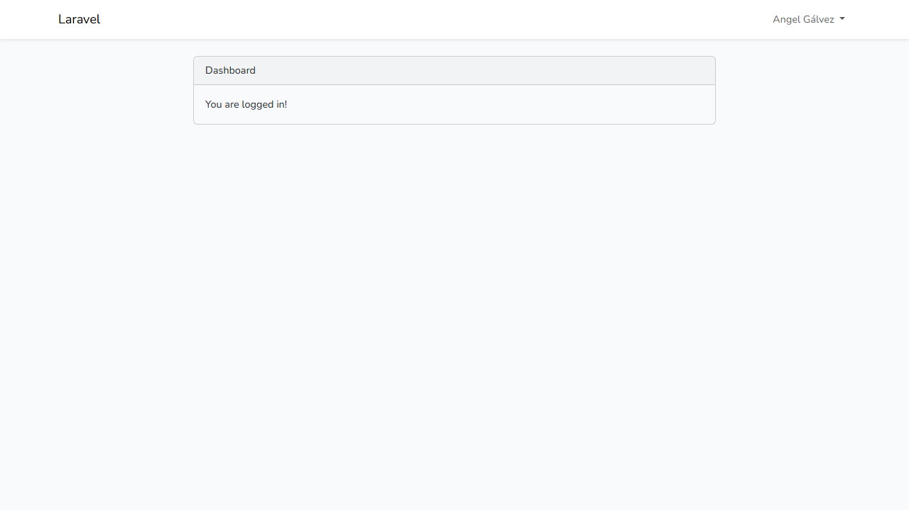
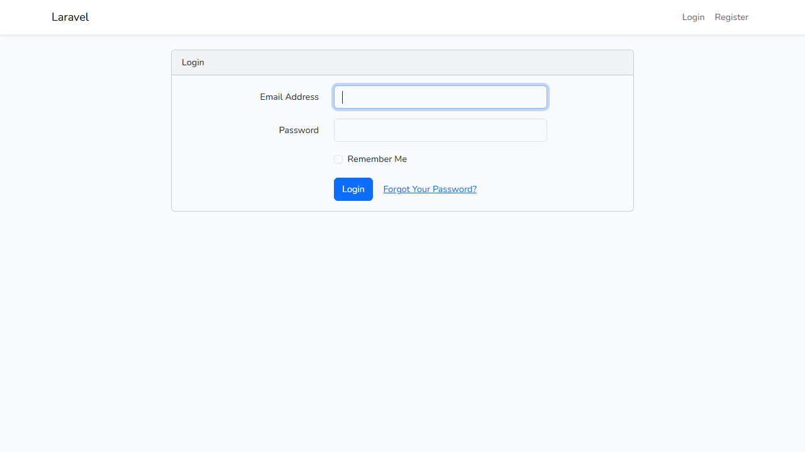
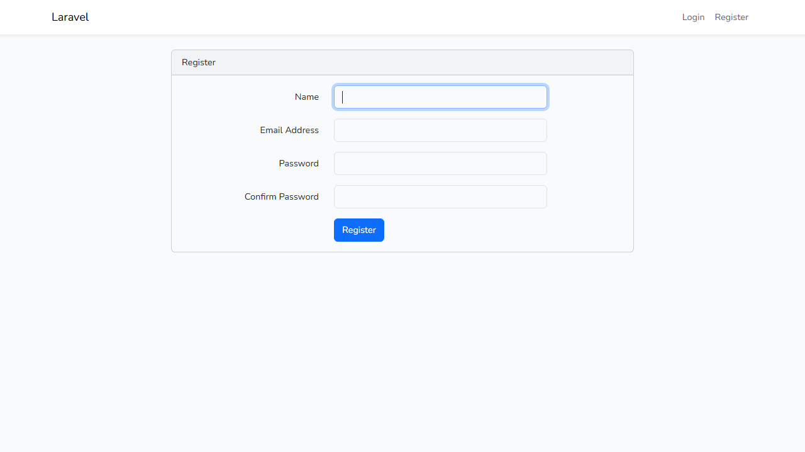
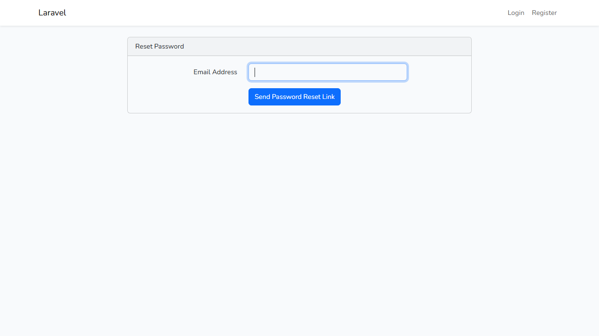

<div align="center">

&nbsp;&nbsp;&nbsp;&nbsp;&nbsp;&nbsp;

# UNIVERSIDAD TECNOLÓGICA DE PANAMÁ

**FACULTAD DE INGENIERÍA DE SISTEMAS COMPUTACIONALES**<br>
**CAMPUS VÍCTOR LEVIS SASSO**<br>
**DESARROLLO WEB**

## 🔐 Laboratorio #2 – Implementación del Login en Laravel

**Unidad I: Modelo Vista Controlador (MVC)** · **Tema:** Patrón MVC<br>
**Lenguaje de programación:** PHP · **II Semestre 2026**<br>
**Instructor:** Ing. Irina Fong

<br>


</div>

---

## 📑 Tabla de contenido

1. [Requisitos previos](#1-requisitos-previos)
2. [Introducción](#2-introducción)
3. [Resultado del laboratorio](#3-resultado-del-laboratorio)
4. [Base de datos](#4-base-de-datos)
5. [Dificultades y soluciones](#5-dificultades-y-soluciones)
6. [Referencias](#6-referencias)
7. [Fecha de ejecución del laboratorio](#7-fecha-de-ejecución-del-laboratorio)
8. [Entrega](#8-entrega)

---

## 1. Requisitos previos

### 1.1 Prerrequisitos (ecosistema de desarrollo del laboratorio)

| | Tecnología | Requisito | Versión utilizada |
|:---:|---|---|---|
|  | **PHP** | Versión 8.0 o superior (Laravel 13 exige 8.3+) | 8.3.28 |
|  | **Composer** | Última versión estable | 2.10.3 |
|  | **Laravel** | Laravel Installer o `composer create-project` | 13.38 |
| 🖥️ | **Paquete de servidor local** | XAMPP, WampServer o Laragon | WampServer (64 bits) |
|  | **Servidor web** | Apache o Nginx | Apache 2.4.65 |
|  | **Base de datos** | MySQL/MariaDB funcionando | MySQL 8.4.7 |
|  | **Editor de código** | Visual Studio Code (recomendado) | Visual Studio Code |
|  | **Node.js / NPM** | Sí fue necesario: compila Bootstrap y Sass con Vite | Node 24.22.1 · npm 11.19.1 |
|  | **Sistema operativo** | — | Windows 11 Home |
|  | **Git / GitHub** | Control de versiones y entrega | Git · GitHub |

Verificación de versiones:

```bash
php -v
composer -V
php artisan --version
node -v
npm -v
```

### 1.2 Instalación de dependencias y configuración del `.env`

Para ejecutar el proyecto a partir de este repositorio:

```bash
git clone https://github.com/galvezangel074-glitch/LARAVEL.git laravel
cd laravel
composer install            # dependencias de PHP (carpeta vendor/)
npm install                 # dependencias de Node (carpeta node_modules/)
copy .env.example .env      # Linux/macOS: cp .env.example .env
php artisan key:generate    # genera APP_KEY
```

En el archivo `.env` se configuró la conexión a MySQL de WampServer:

```dotenv
APP_URL=http://localhost:8000

DB_CONNECTION=mysql
DB_HOST=127.0.0.1
DB_PORT=3306
DB_DATABASE=pruebaregistrolarvel
DB_USERNAME=root
DB_PASSWORD=

SESSION_DRIVER=database
```

### 1.3 Secuencia de comandos utilizada en el laboratorio

```bash
# 1. Crear el proyecto
composer create-project laravel/laravel laravel

# 2. Instalar el paquete de autenticación Laravel/UI
composer require laravel/ui
php artisan ui bootstrap --auth

# 3. Instalar y compilar los estilos (Bootstrap + Sass con Vite)
npm install
npm run build               # durante el desarrollo: npm run dev

# 4. Crear las tablas en MySQL
php artisan migrate

# 5. Levantar el servidor de desarrollo
php artisan serve           # http://127.0.0.1:8000
```

> **Laravel/UI o Breeze:** la tarea permite cualquiera de los dos. En este laboratorio se usó **Laravel/UI**. Con Breeze el flujo habría sido `composer require laravel/breeze --dev` y `php artisan breeze:install`.

### 1.4 Dependencias de Laravel para autenticación

| Gestor | Paquete | Función |
|---|---|---|
| Composer | `laravel/framework ^13.17` | Núcleo del framework |
| Composer | `laravel/ui ^4.6` | Genera controladores, vistas y rutas de login, registro y recuperación de contraseña |
| npm | `bootstrap ^5.2.3` · `@popperjs/core` | Estilos y componentes de las vistas de autenticación |
| npm | `sass` · `vite` · `laravel-vite-plugin` | Compilación de `resources/sass/app.scss` y `resources/js/app.js` |

---

## 2. Introducción

### 🎯 Objetivo del laboratorio

Implementar un **módulo de inicio de sesión (login) en Laravel** siguiendo el patrón **Modelo-Vista-Controlador (MVC)**. La aplicación permite **registrar usuarios, iniciar y cerrar sesión, y recuperar la contraseña**, guardando los datos en una base de datos MySQL. Además, protege el panel principal (`/home`) para que solo lo vea un usuario autenticado.

### 🗂️ Carpetas principales según la arquitectura MVC

| Componente | Carpeta | Función |
|---|---|---|
| **Rutas** | `routes/` | Asocian cada URL con el controlador o la vista que la atiende. |
| **Controladores** | `app/Http/Controllers/` | Reciben la petición, validan los datos, usan los modelos y deciden qué vista devolver. |
| **Modelos** | `app/Models/` | Representan las tablas de la base de datos mediante Eloquent ORM. |
| **Vistas** | `resources/views/` | Plantillas Blade con el HTML que ve el usuario. |
| **Migraciones** | `database/migrations/` | Definen la estructura de las tablas en código PHP. |

Flujo de una petición de login:

```
Navegador ──► routes/web.php ──► LoginController ──► Modelo User ──► MySQL
    ▲                                   │
    └──────── Vista (login / home) ◄────┘
```

### 💻 Código implementado

**Rutas**: [routes/web.php](routes/web.php)

```php
Route::get('/', function () {
    return view('welcome');
});

Auth::routes();   // login, logout, register y password/*

Route::get('/home', [App\Http\Controllers\HomeController::class, 'index'])->name('home');
```

**Controlador**: [app/Http/Controllers/HomeController.php](app/Http/Controllers/HomeController.php)

```php
class HomeController extends Controller
{
    public function __construct()
    {
        $this->middleware('auth');   // sin sesión redirige a /login
    }

    public function index()
    {
        return view('home');
    }
}
```

**Controlador de registro**: [app/Http/Controllers/Auth/RegisterController.php](app/Http/Controllers/Auth/RegisterController.php)

```php
protected function validator(array $data)
{
    return Validator::make($data, [
        'name' => ['required', 'string', 'max:255'],
        'email' => ['required', 'string', 'email', 'max:255', 'unique:users'],
        'password' => ['required', 'string', 'min:8', 'confirmed'],
    ]);
}

protected function create(array $data)
{
    return User::create([
        'name' => $data['name'],
        'email' => $data['email'],
        'password' => Hash::make($data['password']),
    ]);
}
```

**Controlador de login**: [app/Http/Controllers/Auth/LoginController.php](app/Http/Controllers/Auth/LoginController.php)

```php
class LoginController extends Controller
{
    use AuthenticatesUsers;            // lógica de login provista por laravel/ui

    protected $redirectTo = '/home';   // a dónde va el usuario tras iniciar sesión

    public function __construct()
    {
        $this->middleware('guest')->except('logout');
        $this->middleware('auth')->only('logout');
    }
}
```

**Modelo**: [app/Models/User.php](app/Models/User.php)

```php
#[Fillable(['name', 'email', 'password'])]
#[Hidden(['password', 'remember_token'])]
class User extends Authenticatable
{
    use HasFactory, Notifiable;

    protected function casts(): array
    {
        return [
            'email_verified_at' => 'datetime',
            'password' => 'hashed',
        ];
    }
}
```

**Vista**: [resources/views/auth/login.blade.php](resources/views/auth/login.blade.php) (fragmento)

```blade
<form method="POST" action="{{ route('login') }}">
    @csrf
    <input id="email" type="email" name="email" value="{{ old('email') }}" required>
    <input id="password" type="password" name="password" required>
    ...
</form>
```

Otras vistas generadas: `auth/register`, `auth/passwords/email`, `auth/passwords/reset`, `auth/passwords/confirm`, `auth/verify`, `home` y `layouts/app`.

**Rutas generadas por `Auth::routes()`**

| Método | URI | Descripción |
|---|---|---|
| GET | `/` | Página de bienvenida |
| GET / POST | `/login` | Inicio de sesión |
| POST | `/logout` | Cierre de sesión |
| GET / POST | `/register` | Registro de usuarios |
| GET / POST | `/password/reset`, `/password/email`, `/password/reset/{token}` | Recuperación de contraseña |
| GET / POST | `/password/confirm` | Confirmar contraseña |
| GET | `/home` | Panel principal (requiere sesión) |

### 🛠️ Comandos utilizados para las migraciones

```bash
php artisan migrate             # crea las tablas definidas en database/migrations
php artisan migrate:status      # muestra qué migraciones se ejecutaron
php artisan route:list          # verifica las rutas de autenticación creadas
```

---

## 3. Resultado del laboratorio

### Panel principal con la sesión iniciada (`/home`)



<table>
<tr>
<td align="center"><b>Inicio de sesión</b> (<code>/login</code>)<br><br></td>
<td align="center"><b>Registro de usuario</b> (<code>/register</code>)<br><br></td>
</tr>
<tr>
<td align="center" colspan="2"><b>Recuperar contraseña</b> (<code>/password/reset</code>)<br><br></td>
</tr>
</table>

---

## 4. Base de datos

### 4.1 Entorno

| Elemento | Valor |
|---|---|
| Motor | MySQL 8.4.7 (incluido en WampServer) |
| Administración | phpMyAdmin |
| Base de datos | `pruebaregistrolarvel` |
| Usuario / contraseña | `root` / *(vacía, entorno local)* |
| Host / puerto | `127.0.0.1` / `3306` |

### 4.2 Aspectos de Laravel

- **`.env`**: guarda la configuración del entorno. Laravel lee las variables `DB_*` desde [config/database.php](config/database.php). Por defecto el `.env` trae `DB_CONNECTION=sqlite`, y se cambió a `mysql` (ver [sección 1.2](#12-instalación-de-dependencias-y-configuración-del-env)).
- **Migraciones**: archivos en `database/migrations/` que crean las tablas con `Schema::create()`, de modo que la estructura se puede reproducir en cualquier equipo con un solo comando.
- **Modelo `User`**: trabaja sobre la tabla `users`. El cast `'password' => 'hashed'` guarda la contraseña cifrada con bcrypt.
- **Sesiones**: con `SESSION_DRIVER=database`, las sesiones de los usuarios se guardan en la tabla `sessions`.

### 4.3 Comandos para levantar las tablas

```sql
-- 1. Crear la base de datos (en phpMyAdmin o en la consola de MySQL)
CREATE DATABASE pruebaregistrolarvel CHARACTER SET utf8mb4 COLLATE utf8mb4_unicode_ci;
```

```bash
# 2. Ejecutar las migraciones
php artisan migrate
```

Migraciones ejecutadas:

| Migración | Tablas que crea |
|---|---|
| `0001_01_01_000000_create_users_table` | `users`, `password_reset_tokens`, `sessions` |
| `0001_01_01_000001_create_cache_table` | `cache`, `cache_locks` |
| `0001_01_01_000002_create_jobs_table` | `jobs`, `job_batches`, `failed_jobs` |

La tabla `migrations` la crea Laravel para llevar el control de las migraciones ejecutadas.

### 4.4 💾 Respaldo (backup) de la base de datos

📁 Copia en el repositorio: [database/backup/pruebaregistrolarvel.sql](database/backup/pruebaregistrolarvel.sql)

Comando con el que se generó (desde `C:\wamp64\bin\mysql\mysql8.4.7\bin`):

```bash
mysqldump -u root --routines --triggers --databases pruebaregistrolarvel --ignore-table=pruebaregistrolarvel.sessions > pruebaregistrolarvel.sql
mysqldump -u root --no-data --skip-add-drop-table pruebaregistrolarvel sessions >> pruebaregistrolarvel.sql
```

> De la tabla `sessions` solo se respaldó la estructura, sin datos, para no publicar tokens de sesión.

Para restaurar el respaldo:

```bash
mysql -u root < database/backup/pruebaregistrolarvel.sql
```

---

## 5. Dificultades y soluciones

Durante la ejecución del laboratorio se presentó la siguiente complicación:

- **Dificultad 1: Error de conexión con la base de datos en el archivo `.env`.** Laravel 13 crea el proyecto con `DB_CONNECTION=sqlite`, y las variables de MySQL vienen comentadas. Por eso la aplicación no usaba la base de datos de WampServer.
  - **Solución:** se cambió `DB_CONNECTION` a `mysql` y se descomentaron y completaron `DB_HOST`, `DB_PORT`, `DB_DATABASE`, `DB_USERNAME` y `DB_PASSWORD` con los datos de WampServer, sin espacios sobrantes. Después se ejecutó `php artisan migrate` y las tablas se crearon correctamente en `pruebaregistrolarvel`.

---

## 6. Referencias

1. Laravel. (2026). *Authentication*. Documentación oficial de Laravel. https://laravel.com/docs/authentication
2. Laravel. (2026). *Database: Migrations*. Documentación oficial de Laravel. https://laravel.com/docs/migrations
3. Laravel. (2026). *laravel/ui — Laravel UI utilities and presets* [Repositorio]. GitHub. https://github.com/laravel/ui
4. Laravel. (2026). *Asset Bundling (Vite)*. Documentación oficial de Laravel. https://laravel.com/docs/vite
5. Bootstrap. (2026). *Bootstrap 5 Documentation*. https://getbootstrap.com/docs/5.3/
6. Oracle. (2026). *mysqldump — A Database Backup Program*. MySQL 8.4 Reference Manual. https://dev.mysql.com/doc/refman/8.4/en/mysqldump.html

---

## 7. Fecha de ejecución del laboratorio

📅 **22 de octubre de 2026**

---

## 8. Entrega

📌 **Fecha de entrega:** 16 de octubre de 2026 (fecha establecida por la docente)

📌 **Forma de entrega:** a través de este repositorio en GitHub, enlazado en la plataforma académica con hoja de presentación.

🔗 **Repositorio:** https://github.com/galvezangel074-glitch/LARAVEL

---

<div align="center">

Este laboratorio ha sido desarrollado por el estudiante de la **Universidad Tecnológica de Panamá**:

**Nombre:** Angel Gálvez<br>
**Correo:** angel.galvez2@utp.ac.pa<br>
**Curso:** Desarrollo Web (Grupo 1S3122)<br>
**Instructor del Laboratorio:** Irina Fong

</div>
